<picture>
  <source media="(prefers-color-scheme: dark)" srcset="./dark.svg">
  <source media="(prefers-color-scheme: light)" srcset="./light.svg">
  
</picture>

 

---

## `> whoami`

I'm a final-year **Computer Science and Design Engineering** student in Bengaluru who likes turning ideas into working systems. I build **AI-powered platforms, software applications and IoT systems**, mostly around **computer vision, speech AI, backend services and optimization**, and I focus on real-world problems: farm and workforce access, railway safety, disaster response, aviation safety.

| | |
|---|---|
| 🎓 **Education** | B.E. Computer Science & Design Engineering · Atria Institute of Technology (VTU) · 2023 – 2027 |
| 🏆 **Highlights** | Top 4 at the Smart India Hackathon Internal Hackathon (Software Edition) with **SatQuery AI** · Top 8 of 60+ projects in my full stack internship cohort with **Campus Connect** |
| 🛠️ **Building now** | **SafeComm**, a real-time aviation speech AI system |

> 🚧 This README is a work in progress. More projects are on the way and this page will grow with them.

---

## `> project.flow`

<picture>
  <source media="(prefers-color-scheme: dark)" srcset="./projects-dark.svg">
  <source media="(prefers-color-scheme: light)" srcset="./projects-light.svg">
  
</picture>

---

## `> featured.projects`

### 01 · UdyogaSethu — Multilingual Workforce & Farm Marketplace
A multilingual, **voice-first** platform that connects informal workers and small farmers with customers and local businesses through **GPS-based service matching** and farm-to-consumer commerce. A built-in **trust & safety layer** covers identity verification, QR job verification, face/liveness checks, GPS tracking, SOS and secure communication.

### 02 · SatQuery AI — Satellite Vision-Language Assistant
An AI assistant for **natural-language interaction with satellite imagery**. It analyzes optical and SAR data to identify land features and monitor the environment, and runs **multitemporal comparison and change detection** to deliver evidence-grounded insights and change maps. *Top 4, SIH Internal Hackathon (Software Edition).*
`Python` · [Repository](https://github.com/chethankp365/SatQuery-AI)

### 03 · Rakshaan — AI-Powered Autonomous Disaster-Response Drone
An autonomous drone that uses **RGB and thermal vision** to detect survivors and hazards while navigating difficult environments, and sends survivor locations, hazards and risk information to rescue teams in real time for a faster response. Built as a search & rescue drone platform for SIH 2026.
`TypeScript` · [Repository](https://github.com/chethankp365/Rakshaan)

### 04 · EcoBrain
_Details coming soon._

### 05 · Aahat — AI Predictive Railway Safety & Defect Digital Twin
A multi-sensor railway safety system that "listens" to the track. It fuses **acoustic, vibration, vision and GPS** data, confirms a defect only when two or more sensors agree, pins it on a **digital twin**, scores its severity and **forecasts when it becomes critical**. The prototype runs on simulated data, with real-track validation on the roadmap.
`Raspberry Pi 4` · `Python` · `TensorFlow Lite` · `React` · [Repository](https://github.com/chethankp365/Aahat) · [Live demo](https://aahat.vercel.app)

### 🛠️ Building now · SafeComm — Real-Time Aviation Speech AI
A real-time speech AI system built with **Python, PyTorch, Whisper and FastAPI** that transcribes ATC radio, extracts flight instructions and detects incorrect pilot read-backs within about **2 seconds**. It adds confidence-aware alerts with **ADS-B and ATIS cross-checking**, a live monitoring dashboard and error-injection testing.

### Also built · RestWing — Fatigue-Aware Crew Rostering & Recovery Engine
An airline crew rostering engine using **OR-Tools CP-SAT, Column Generation and LNS** to schedule **600 crew across 2,000 flights** within the rules. It integrates a bio-mathematical fatigue model and a disruption recovery engine that **re-plans affected rosters in under 5 seconds**.

---

## `> journey.log`

<picture>
  <source media="(prefers-color-scheme: dark)" srcset="./journey-dark.svg">
  <source media="(prefers-color-scheme: light)" srcset="./journey-light.svg">
  
</picture>

**Full Stack Web Development Intern** · Rotaract Club of Atria I.T. × Dept. of CSE · Mar 2025 – Jun 2025
Built **Campus Connect**, a full-stack campus communication platform on the MERN stack (React.js, Node.js, Express.js, MongoDB). Ranked in the **Top 8 of 60+ projects** across the cohort.

**Virtual UI/UX Design Intern** · CodSoft · Jun 2026 – Jul 2026
Designed end-to-end user flows and high-fidelity interfaces in Figma, from wireframes and interactive prototypes to polished UI screens, refined against usability requirements.

---

## `> stack.map`

<picture>
  <source media="(prefers-color-scheme: dark)" srcset="./skills-dark.svg">
  <source media="(prefers-color-scheme: light)" srcset="./skills-light.svg">
  
</picture>

---

## `> certifications`

| Certification | Issued by |
|---|---|
| Artificial Intelligence Fundamentals | IBM SkillsBuild |
| Java Spring Boot Backend Development | Coursera |
| Apply API Testing & Automation with Postman | EDUCBA, Coursera |
| Unmanned Aerial Systems: Operations | University of Alaska Fairbanks, Coursera |
| Programming in C | Infosys Springboard |
| Programming Using Java | Infosys Springboard |

---

## `> connect`

Open to conversations about AI, computer vision, backend and optimization projects. The fastest way to reach me is [email](mailto:chethankp365@gmail.com) or [LinkedIn](https://www.linkedin.com/in/chethan-kumar-kp17/). You can also read my [resume](https://drive.google.com/file/d/1ql_ltsz6ATxShFthLh8isdJ55G_tSCTB/view?usp=sharing).

`// more projects loading…`

