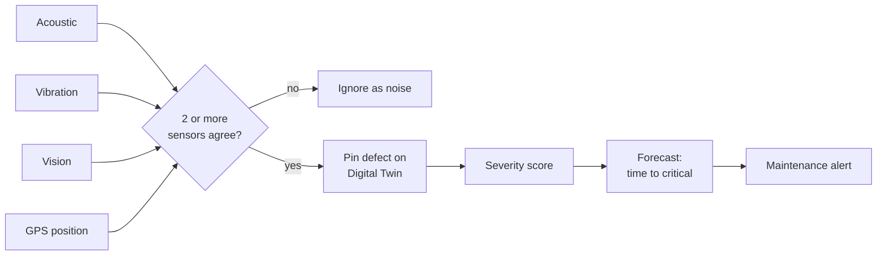

 

> 🎬 **How to read this chapter:** every mission has a flow diagram. Follow the glowing packet left to right and wait for the sound effect at the end. Expand the **🧠 deep dive** under a mission to see how the theory works.

 

<!-- ============ 01 NO ENTRY ============ -->

### 🔴 ISSUE #01 · NO ENTRY — AI-Powered Cybersecurity Training Platform & Isolated Cyber Range
An **80-room training platform across 4 tracks** (Red, Blue, Purple, Detection Engineering). Learners run **real commands inside live Docker containers**, not fake terminal output. All **20 Red Team rooms** are built (recon, SQL injection, XSS, command injection, privilege escalation and more), guided by **GHOST**, a multi-provider AI mentor, and backed by **168 passing automated tests**.

`Python` `FastAPI` `Docker` `SQLModel` `PostgreSQL` `WebSockets` `JavaScript` `YAML` `MITRE ATT&CK`

 

<b>🧠 Deep dive: how one lab session works</b>

 

<!-- ============ 02 UDYOGASETHU ============ -->

### 🟢 ISSUE #02 · UdyogaSethu — Multilingual Workforce & Farm Marketplace
A **voice-first** mobile platform connecting informal workers and small farmers with customers through **GPS-based matching** and farm-to-consumer commerce. It orchestrates **5 AI services** (Deepgram, Groq, Gemini, OpenRouter, Hugging Face) and protects users with a **6-safeguard trust layer** (identity + QR job verification, face/liveness checks, live GPS tracking, one-tap SOS, secure chat) enforced by **PostgreSQL Row Level Security**. Ships with a **Spring Boot + Vaadin admin portal** and 3 Figma-prototyped user journeys.

`Flutter` `Supabase` `PostGIS` `RLS` `Edge Functions` `Spring Boot` `Vaadin` `Deepgram` `Groq` `Gemini`

[-39FF14?style=for-the-badge&logo=github&logoColor=black&labelColor=07040d)](https://github.com/chethankp365/UdyogaSethu)  

<b>🧠 Deep dive: the trust layer</b>

 

<!-- ============ 03 SAFECOMM ============ -->

### 🟣 ISSUE #03 · SafeComm — Real-Time Aviation Speech AI
Transcribes **ATC radio**, extracts flight instructions and catches **incorrect pilot read-backs within ~2 seconds**, with a **sub-5 ms local regex fallback**. Alerts are cross-checked against live **ADS-B and ATIS** data with confidence-aware scoring, and the monitoring dashboard ships with error-injection testing.

`React` `TypeScript` `Python` `Whisper` `FastAPI` `Supabase` `Gemini` `Groq`

 

<b>🧠 Deep dive: what is a "read-back" and why does it matter?</b>

A controller gives an instruction and the pilot must **read it back**. A wrong read-back that nobody catches (wrong altitude, wrong runway) is a classic root cause of incidents. SafeComm is the safety net that listens for those mismatches.

 

<!-- ============ 04 SATQUERY ============ -->

### 🟡 ISSUE #04 · SatQuery AI — Satellite Vision-Language Assistant
Ask questions about satellite imagery in plain language. The **agentic assistant** (Gemini 2.5 VLM) routes each query to **YOLOv8 detection, SSIM/CVA change detection, NDVI/NDWI/NBR indices and SAR–optical fusion**, then answers with **evidence-grounded insights and change maps** through a COG/GeoJSON pipeline with a MongoDB audit trail. 🏆 **Top 4, Smart India Hackathon Internal (Software Edition).**

`React` `TypeScript` `Python` `Gemini 2.5` `YOLOv8` `GDAL / GeoTIFF` `MongoDB`

 

 

<!-- ============ 05 CAMPUS CONNECT ============ -->

### 🔴 ISSUE #05 · Campus Connect — Full-Stack Campus Communication Platform
Built during my **Full Stack Web Development internship** (Rotaract Club of Atria I.T. × Dept. of CSE) on the **MERN stack**. Ranked 🏅 **Top 8 of 60+ projects** in the cohort.

`MongoDB` `Express.js` `React` `Node.js`

 

 

<!-- ============ 06 AAHAT ============ -->

### 🟢 ISSUE #06 · Aahat — AI Predictive Railway Safety & Defect Digital Twin
A multi-sensor system that **listens to the track**. It fuses **acoustic, vibration, vision and GPS** data, confirms a defect **only when two or more sensors agree**, pins it on a **digital twin**, scores severity and **forecasts when it turns critical**. The prototype runs on simulated data; real-track validation is on the roadmap.

`Raspberry Pi 4` `Python` `TensorFlow Lite` `React`

 

<b>🧠 Deep dive: the "2 sensors must agree" rule</b>

One noisy sensor should never stop a train. Aahat raises a defect only when independent sensors **corroborate** each other, which cuts false alarms.

 

<!-- ============ 07 RAKSHAAN ============ -->

### 🟣 ISSUE #07 · Rakshaan — AI-Powered Autonomous Disaster-Response Drone
An autonomous search & rescue drone that uses **RGB + thermal vision** to detect survivors and hazards while navigating difficult terrain, then sends **survivor locations, hazards and risk information** to rescue teams in real time. Built for **SIH 2026**.

`TypeScript` `RGB + Thermal Vision` `Autonomous Navigation`

 

<!-- ============ 08 ECOBRAIN ============ -->

### 🟡 ISSUE #08 · EcoBrain
The live demo is online. The full origin story is coming soon.

 

**🔴 Cyber Security Intern** · Cynaris Solutions Pvt. Ltd. · *Nov 2026 – Present*
Personal Kali Linux lab with vulnerable VMs, network recon and vuln scans, OWASP Top 10 assessments, controlled exploitation and privilege escalation, digital forensics on disk images and memory dumps, and CVSS-rated pentest reports with remediation guidance.

**🟡 Virtual UI/UX Design Intern** · CodSoft · *Jun 2026 – Jul 2026*
User flows, wireframes and interactive prototypes in Figma, refined against usability.

**🟣 Full Stack Web Development Intern** · Rotaract Club of Atria I.T. × Dept. of CSE · *Mar 2025 – Jun 2025*
Built **Campus Connect** on the MERN stack and ranked Top 8 of 60+ projects.

| 🎖️ Certification | 🏛️ Issued by |
|---|---|
| Ethical Hacker | Cisco Networking Academy |
| Artificial Intelligence Fundamentals | IBM SkillsBuild |
| Apply API Testing & Automation with Postman | EDUCBA, Coursera |
| Unmanned Aerial Systems: Operations | University of Alaska Fairbanks, Coursera |
| Java Spring Boot Backend Development | Coursera |
| Programming in C · Programming Using Java | Infosys Springboard |

Stay for the post-credits scene: I'm open to **internships, collaborations and conversations** about AI, computer vision, cybersecurity, backend and optimization. The fastest way to reach me is [email](mailto:chethankp365@gmail.com) or [LinkedIn](https://www.linkedin.com/in/chethan-kumar-kp17/). You can also browse my [portfolio](https://chethankumar-portfolio.vercel.app/) or read my [resume](https://drive.google.com/file/d/1ql_ltsz6ATxShFthLh8isdJ55G_tSCTB/view?usp=sharing).

