

 



 

I'm a final-year Computer Science & Design Engineering student in Bengaluru. I build AI-powered platforms, full-stack applications and IoT systems across **computer vision, speech AI, backend engineering, optimization and cybersecurity**, with a focus on real-world problems: workforce and farm access, railway safety, disaster response, aviation safety and cyber defense.

I'm currently a **Cyber Security Intern at Cynaris Solutions**, working on a Kali Linux lab, OWASP Top 10 assessments, controlled exploitation, digital forensics and CVSS-rated penetration testing reports, while building **NO ENTRY**, an AI-powered cyber range.



Each project includes an animated architecture flow. Where a concept needs more explanation, expand the **Technical notes** section underneath it.

 

<!-- ============ 01 NO ENTRY ============ -->

### NO ENTRY — AI-Powered Cybersecurity Training Platform & Isolated Cyber Range
An 80-room training platform across four tracks (Red Team, Blue Team, Purple Team, Detection Engineering). Learners run **real commands inside live Docker containers** rather than simulated terminals. All 20 Red Team rooms are implemented (reconnaissance, SQL injection, XSS, command injection, privilege escalation and more), supported by **GHOST**, a multi-provider AI mentor, and validated by **168 passing automated tests**.

`Python` `FastAPI` `Docker` `SQLModel` `PostgreSQL` `WebSockets` `JavaScript` `YAML` `MITRE ATT&CK`

 

<b>Technical notes: how a lab session works</b>

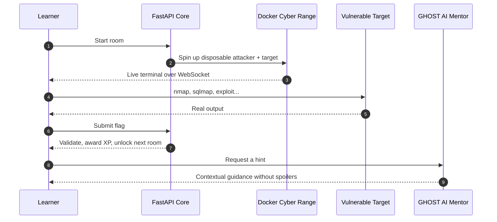

 

<!-- ============ 02 UDYOGASETHU ============ -->

### UdyogaSethu — Multilingual Workforce & Farm Marketplace
A voice-first mobile platform connecting informal workers and small farmers with customers through **GPS-based service matching** and farm-to-consumer commerce. It integrates **five AI services** (Deepgram, Groq, Gemini, OpenRouter, Hugging Face) and applies a **six-safeguard trust and safety layer**: identity and QR job verification, face/liveness checks, live GPS tracking, one-tap SOS and secure chat, enforced with PostgreSQL Row Level Security. Includes a Spring Boot + Vaadin admin portal and three Figma-prototyped user journeys.

`Flutter` `Supabase` `PostGIS` `RLS` `Edge Functions` `Spring Boot` `Vaadin` `Deepgram` `Groq` `Gemini`

[-34d399?style=flat-square&logo=github&logoColor=34d399&labelColor=0a0e0c)](https://github.com/chethankp365/UdyogaSethu)  

<b>Technical notes: the trust layer</b>

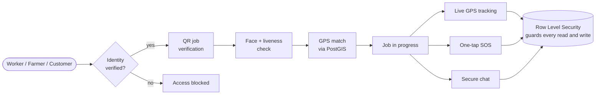

 

<!-- ============ 03 SAFECOMM ============ -->

### SafeComm — Real-Time Aviation Speech AI
Transcribes ATC radio, extracts flight instructions and detects **incorrect pilot read-backs within about 2 seconds**, with a sub-5 ms local regex fallback. Alerts are cross-checked against live ADS-B and ATIS data using confidence-aware scoring, and the monitoring dashboard includes error-injection testing.

`React` `TypeScript` `Python` `Whisper` `FastAPI` `Supabase` `Gemini` `Groq`

 

<b>Technical notes: what is a read-back and why does it matter?</b>

A controller issues an instruction and the pilot must read it back. An unnoticed mismatch (wrong altitude, wrong runway) is a classic root cause of aviation incidents. SafeComm acts as an independent safety net that listens for those mismatches.

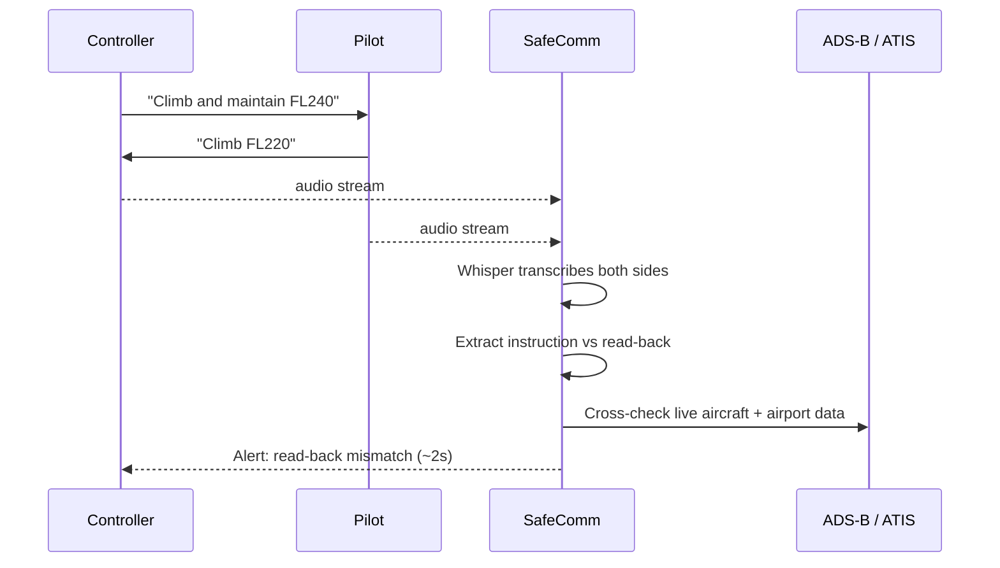

 

<!-- ============ 04 SATQUERY ============ -->

### SatQuery AI — Satellite Vision-Language Assistant
Ask questions about satellite imagery in plain language. An agentic assistant (Gemini 2.5 VLM) routes each query to **YOLOv8 detection, SSIM/CVA change detection, NDVI/NDWI/NBR indices and SAR–optical fusion**, then returns evidence-grounded insights and change maps through a COG/GeoJSON pipeline with a MongoDB audit trail. **Top 4, Smart India Hackathon Internal (Software Edition).**

`React` `TypeScript` `Python` `Gemini 2.5` `YOLOv8` `GDAL / GeoTIFF` `MongoDB`

 

 

<!-- ============ 05 CAMPUS CONNECT ============ -->

### Campus Connect — Full-Stack Campus Communication Platform
Built during my Full Stack Web Development internship (Rotaract Club of Atria I.T. × Dept. of CSE) on the MERN stack. Ranked in the **Top 8 of 60+ projects** in the cohort.

`MongoDB` `Express.js` `React` `Node.js`

 

 

<!-- ============ 06 AAHAT ============ -->

### Aahat — AI Predictive Railway Safety & Defect Digital Twin
A multi-sensor system that "listens" to the track. It fuses **acoustic, vibration, vision and GPS** data, confirms a defect only when **two or more sensors agree**, pins it on a **digital twin**, scores severity and **forecasts when it becomes critical**. The prototype runs on simulated data; real-track validation is on the roadmap.

`Raspberry Pi 4` `Python` `TensorFlow Lite` `React`

 

<b>Technical notes: the multi-sensor agreement rule</b>

A single noisy sensor should not trigger a false alarm. Aahat raises a defect only when independent sensors corroborate each other, which reduces false positives.

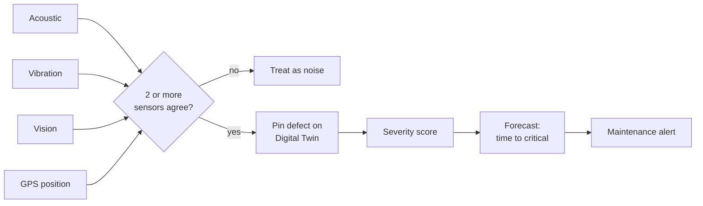

 

<!-- ============ 07 RAKSHAAN ============ -->

### Rakshaan — AI-Powered Autonomous Disaster-Response Drone
An autonomous search-and-rescue drone that uses **RGB and thermal vision** to detect survivors and hazards while navigating difficult terrain, and sends survivor locations, hazards and risk information to rescue teams in real time. Built for SIH 2026.

`TypeScript` `RGB + Thermal Vision` `Autonomous Navigation`

 

<!-- ============ 08 ECOBRAIN ============ -->

### EcoBrain
A live demo is available. A full write-up is coming soon.

 



**Cyber Security Intern** · Cynaris Solutions Pvt. Ltd. · *Nov 2026 – Present*
Personal Kali Linux lab with vulnerable VMs; network reconnaissance and vulnerability scans; OWASP Top 10 assessments; controlled exploitation and privilege escalation; digital forensics on disk images and memory dumps; CVSS-rated penetration testing reports with remediation guidance.

**Virtual UI/UX Design Intern** · CodSoft · *Jun 2026 – Jul 2026*
User flows, wireframes and interactive prototypes in Figma, refined against usability.

**Full Stack Web Development Intern** · Rotaract Club of Atria I.T. × Dept. of CSE · *Mar 2025 – Jun 2025*
Built Campus Connect on the MERN stack; ranked Top 8 of 60+ projects.





| Certification | Issued by |
|---|---|
| Ethical Hacker | Cisco Networking Academy |
| Artificial Intelligence Fundamentals | IBM SkillsBuild |
| Apply API Testing & Automation with Postman | EDUCBA, Coursera |
| Unmanned Aerial Systems: Operations | University of Alaska Fairbanks, Coursera |
| Java Spring Boot Backend Development | Coursera |
| Programming in C · Programming Using Java | Infosys Springboard |

I'm open to internships, collaborations and conversations about AI, computer vision, cybersecurity, backend engineering and optimization. The best ways to reach me are [email](mailto:chethankp365@gmail.com) and [LinkedIn](https://www.linkedin.com/in/chethan-kumar-kp17/). You can also visit my [portfolio](https://chethankumar-portfolio.vercel.app/) or view my [resume](https://drive.google.com/file/d/1ql_ltsz6ATxShFthLh8isdJ55G_tSCTB/view?usp=sharing).

